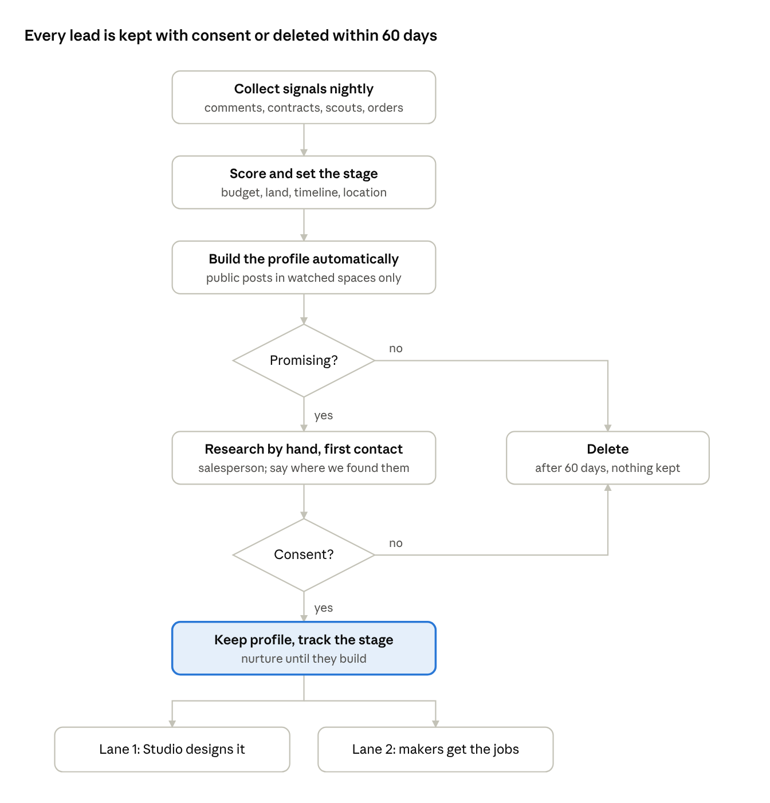
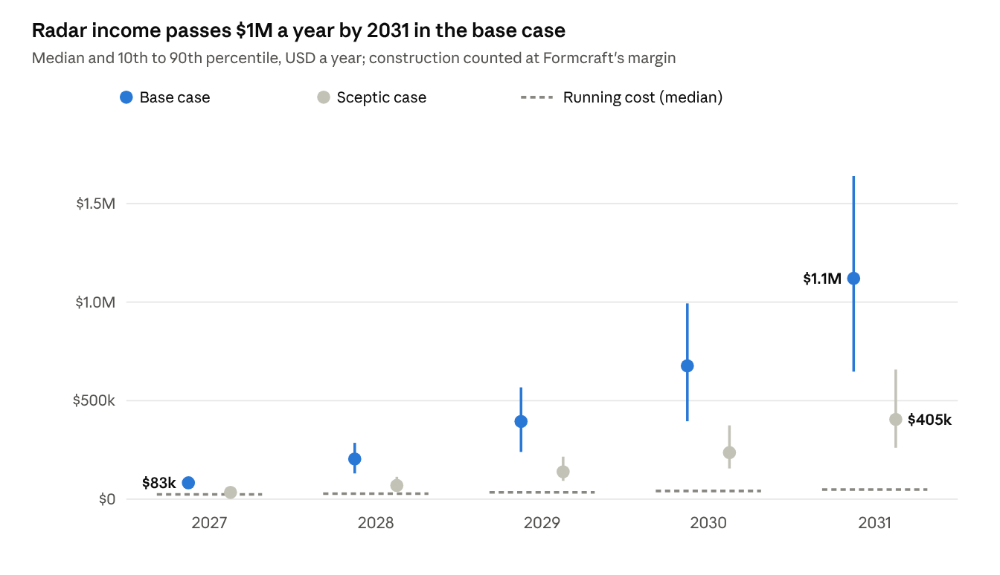
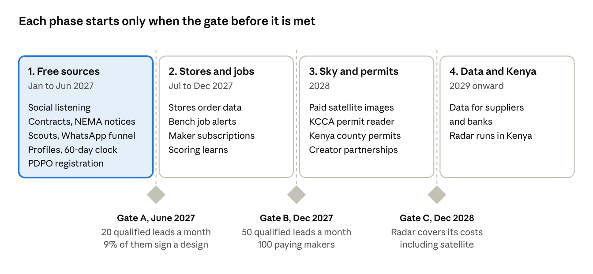

# Formcraft Radar: Feasibility Study

31 October 2026 · Emlyn Atochon · Live version: https://claude.ai/artifact/Cd9j7VLMuvjQiwkZWLMcZr (private to the owner)

## Summary

**Verdict: feasible. Build it in three phases, starting with free data in early 2027.** Formcraft Radar is one system that finds people about to build, builds a profile on each promising lead, and routes the work two ways: design clients to Formcraft Studio, and building jobs to Formcraft's maker community.

- **Money, base case (median):** about USD 83,000 of Radar-sourced income in 2027, rising to about USD 1.1 million in 2031, on running costs of USD 24,000 to 49,000 a year. Construction counts at Formcraft's margin, not contract value.
- **Money, sceptic case:** half the signals, half the win rate, lower fees. It still covers its costs from 2028; in 2027 it breaks even in 61% of futures.
- **The main finding:** leads are not the limit, design capacity is. In 89% of futures, 2027 already brings more qualified leads than the Studio can design for. Hiring and the template catalogue decide how much of the Radar's value Formcraft keeps.
- **Why Formcraft can win:** it is the only firm in the region that can find the client before design, design the house, and pass the build to its own trained makers.
- **How profiles work:** the system builds a profile automatically from what people post publicly in the construction spaces it watches. A salesperson checks other public accounts by hand for leads worth chasing. Unqualified profiles are deleted after 60 days. Consent is asked at first contact, and only consenting leads are kept long term.

## The idea

The Radar follows each building project from the moment someone thinks about it to the day they move in, and makes money at every stage. The idea comes from a Tampa tool that reads county permits every night and alerts painters the day a general contractor is named. Uganda has no nightly permit feed yet, so Formcraft combines many weaker signals instead.

| Lane | Who it finds | What Formcraft sells | Who acts |
| --- | --- | --- | --- |
| 1. Clients | People with land or plans, before design | Design, permits, design-and-build, interiors, Stores | Studio and sales |
| 2. Jobs | Sites and contracts that need trades now | Maker subscriptions, placement fees | Makers through Bench |
| 3. Data | Area and stage trends across many sites | Reports and alerts for suppliers, banks and contractors | From 2029 |

The lanes feed each other. A client won in Lane 1 becomes a Formcraft design, and when it reaches the build stage its jobs go to Lane 2. Every site seen in Lane 2 sharpens the data sold in Lane 3.

## Why now

Uganda is in a building boom, and the data to track it is becoming public faster than competitors are using it.

- **Demand:** construction grew 19.4% in the three months to December 2025, against 12.3% for industry as a whole ([Business Front](https://businessfront.com/finance/news/uganda-gdp-surges-8-5-in-q4-2025/)). The World Bank's July 2026 update calls construction an engine for jobs ([World Bank](https://www.worldbank.org/en/country/uganda/publication/uganda-economic-update-27)).
- **Government contracts are already open data:** Uganda's procurement records hold 159,364 awards and 142,168 contracts from July 2015 to October 2026 ([Open Contracting](https://data.open-contracting.org/en/publication/130)). Best evaluated bidder notices name the winning contractor about ten working days before the contract is signed ([KCCA notice](https://www.kcca.go.ug/media/docs/Best-Evaluated-Bidder-Notice-RME-Lot4.pdf)), when the contractor starts lining up subcontractors.
- **Private permits are next:** in May 2026 KCCA announced plans to digitise building permit issuance ([AllAfrica](https://allafrica.com/stories/202605200606.html)). A permit reader built now can go live the day the system opens.
- **The tools are cheap:** free satellite data, Google's building-change maps for Africa ([Google Research](https://sites.research.google/gr/open-buildings/temporal)), low-cost AI to read notices and comments, and Formcraft's own Command Centre to run it.

## Data sources

Seven of the ten sources are usable in 2027 at low cost; satellite, permit and utility data come later. No single source is enough: the Radar scores a lead higher each time a second source confirms it.

| Source | What it shows | Lane | Stage it catches | Cost | Ready |
| --- | --- | --- | --- | --- | --- |
| Public construction talk (YouTube, Facebook groups, TikTok, search) | People asking about plans, budgets, land | 1 | Thinking, land bought | Low | 2027 Q1 |
| Formcraft website, templates, price calculator | Visitors pricing a house | 1 | Thinking, design | Free | 2027 Q1 |
| Plot sellers, surveyors, land brokers, lenders | New land owners and loans | 1 | Land bought | Referral fee | 2027 Q1 |
| Government contract awards (procurement portal) | Winning contractor, price, project | 2 | Contractor named | Low | 2027 Q1 |
| Environmental review notices (NEMA) | Large private projects: hotels, malls, estates | 1, 2 | Before build | Low | 2027 Q2 |
| Maker scouts and site boards (photo + GPS) | Live sites, contractor and architect named | 2 | Any build stage | USD 1–3 per verified site | 2027 Q2 |
| Formcraft Stores and partner hardware orders | Material bought = stage (blocks, roofing, tiles) | 2, 3 | Walling to finishing | Data-sharing terms | 2027 Q3 |
| Satellite change (free Sentinel-2, then paid daily images) | Cleared plots, new roofs, estates growing | 1, 2, 3 | Plot cleared, roofing | USD 3,000–12,000 a year | 2028 |
| KCCA and county e-permits (Uganda, Kenya) | Approved plans and owners | 1, 2 | Permit approved | Low | When online |
| Water and power construction connections | Sites starting work | 2 | Start of build | Partnership | Long term |

## How it works

The system does everything up to the decision to chase a lead; people decide who is worth researching and make the first contact. A lead that is not yet promising stays on the list for up to 60 days and is re-scored with every new signal, so a later post about buying land can still lift it to qualified.

**What a profile holds, and where it comes from**

- **Built automatically:** the public posts and comments one account makes in the construction spaces the Radar watches, the area, the budget and plot details they mention, and an urgency score.
- **Added by the salesperson** for promising leads only: what their other public profiles show that matters for the build (family size, style, timing), as a short note.
- **Added with consent:** name and phone, documents they upload (title, survey, sketches), every conversation, and a stage that updates as they move from land to design, permit, build and finishing.
- **Never in a profile:** private messages, data bought from telecoms or brokers, children's data, or anything about health, religion or politics.

**Stage drives what happens next:** "land bought" gets the design offer, "design signed" gets permit support, "permit approved" opens the build and sends trade jobs to makers, and "moved in" asks for a referral.

## Technology and automation

Everything except choosing who to chase and the first contact runs without people. The Radar is built from parts Formcraft already has, so it is mostly new collectors and a new agent, not a new platform.

| Part | What it does | Built on | Automated |
| --- | --- | --- | --- |
| Collectors | Read comments, contract notices, NEMA notices, store orders and scout photos each night | Scripts on the Windows hub or a small cloud server | Fully |
| Reader | AI pulls out who, where, budget, stage and contractor; reads site boards and title photos | Command Centre AI layers (rules first, masking, guard) | Fully |
| Scorer | Scores urgency and fit, and merges repeat signals about one site or account | Rules, then a model trained on which leads converted | Fully |
| Lead and profile registers | Profiles, stage, consent record, 60-day deletion clock | Command Centre on Firebase | Fully |
| Sales agent | Drafts the first message for each lead and books calls | Command Centre agent at autonomy level L2 (a person approves) | Drafts only |
| WhatsApp funnel | Asks budget, land, title and timeline; quotes from the price book | WhatsApp Business API | Fully, opt-in only |
| Bench alerts | Sends matching jobs to makers by trade and district | Bench app | Fully |
| Listening on own channels | Replies to comments on Formcraft's YouTube, Facebook and TikTok with an answer and a link | Platform APIs | Fully |
| Replies on others' channels | Helpful replies on other creators' videos, a few a day | AI draft, a person posts | Drafts only |

Three rules keep the platforms open to Formcraft: no mass link-dropping on other people's videos (YouTube treats it as comment spam), partner with creators instead (pinned comments, sponsorships, a fee per client), and use official APIs where they exist.

## Costs

The Radar costs about USD 24,000 in 2027, including the build, rising to about USD 49,000 a year by 2031 (medians of the model). People are the largest cost; data and AI stay small.

| Item | Assumption (USD) | When |
| --- | --- | --- |
| Build: collectors, scorer, registers, funnel | 8,000–20,000 once, mostly Formcraft's own developer time | 2027 |
| Researcher and salesperson | 3,600–6,000 in 2027, then 6,000–12,000 a year, rising 50% a year as the team grows | From 2027 |
| AI and hosting | 1,200–4,800 a year, rising 60% a year with volume | From 2027 |
| Scout bounties | 1–3 per verified site, plus 500–1,500 a year for photos and checks | From 2027 Q2 |
| WhatsApp and SMS messages | 0.02–0.06 per message | From 2027 |
| Data protection registration, privacy notice, legal review | 500–1,500 a year | From 2027 |
| Satellite images | 3,000–12,000 a year | From 2028 |

Not counted here: the design staff who deliver the extra Studio work. The model takes that out of income through the Studio margin (next section).

## Revenue and projection

In the base case the Radar pays for itself in its first year and brings in about USD 1.1 million in 2031; even the sceptic case covers its costs from 2028.

In the base case, 2031 income is about 51% design fees, 32% construction margin, 13% maker subscriptions and placements, and 4% data sales. Lane 1 drives the value; Lane 2 matters more for the maker community than for income.

**The limit is design capacity.** Base-case leads reach 26 qualified a month in 2027 and about 200 in 2031. The model caps signed design clients at 20, 45, 90, 160 and 260 a year to match hiring, and that cap binds in 89% of futures in 2027 and about 58% in 2031. Without more designers and the template catalogue, most of the extra leads are wasted.

| Assumption | Base case | Sceptic case |
| --- | --- | --- |
| Public intent signals a month, 2027 | 150–500, growing 45–90% a year | 75–250 |
| Signals that qualify after research | 5–12% | 5–12% |
| Qualified leads that sign a design | 6–14% (the plan's 30% visit × 30% won ≈ 9%) | 3–7% |
| Design fee per client | USD 1,500–4,000 | USD 1,000–2,500 |
| Studio margin after design staff time | 40–55% | 40–55% |
| Design clients who also build with Formcraft | 12–30%, contract USD 40,000–120,000 at 8–14% margin | same |
| Paying makers, 2027 | 50–200 at USD 3–6 a month, growing 50–100% a year | same |
| Placements | 3–10 a month in 2027 at USD 50–150 each | same |
| Data subscribers from 2029 | 2–8 at USD 150–500 a month | same |

These are planning assumptions, not measured results. The first six months of real conversion data should replace them, and the gates in the roadmap are set to test them. The figures count all Radar-sourced clients; some would have come to Formcraft anyway. Run the model with `python3 radar/radar_model.py` (base) and `python3 radar/radar_model_sceptic.py` (sceptic).

## Risks

The biggest risks are running out of design capacity and losing access to the platforms the leads come from; data protection is the risk that grows as Formcraft grows.

| Risk | Likelihood | Impact | Mitigation |
| --- | --- | --- | --- |
| Leads outrun design capacity | High | Leads wasted, slow replies hurt the brand | Hire to the gates, sell templates to smaller budgets, pass overflow to partner architects for a fee |
| Platforms restrict accounts or comments | Medium | Lane 1 loses its main source | Official APIs, no mass link-dropping, creator partnerships, own channels and website as the core |
| Data protection enforcement | Low today, rising | Fines, a news story, investor and Kenya due diligence | Register with the Personal Data Protection Office ([14,000 organisations registered so far](https://eagle.co.ug/2026/08/19/over-500000-ugandan-firms-collect-personal-data-without-registration-pdpo/)), privacy notice, 60-day deletion, consent log, no bought or telecom data |
| Weak signals and false leads | High early | Wasted sales time | Score from two or more sources, learn from which leads converted, review scores monthly |
| Government data has gaps | Medium | Fewer Lane 2 jobs | Add district and KCCA notice boards, scouts, and contractor relationships |
| Makers do poor work on placed jobs | Medium | Contractors stop using the Radar | Only Formcraft-trained or rated makers get jobs; ratings after every job |
| Scouts send fake or duplicate sites | Medium | Bounty costs, bad data | GPS and time checks on photos, pay only after a second source confirms |
| Competitors copy the idea | Medium, after 2028 | Lower win rates | Speed, the design-to-build chain, and the maker network are hard to copy |
| Key person: one researcher holds the process | Medium | Leads stall | Written rulebook for the sales agent, the Command Centre runs the steps |

## Roadmap and measures

Start with free sources in January 2027 and spend on satellite images only after Gate B shows the leads convert. Gates A and B use the lead targets already in the Pioneer plan.

**Measures, tracked automatically in the Command Centre:** qualified leads a month by source, cost per signed client, days from first signal to first contact, signed designs from the Radar, share of unqualified profiles deleted on time (target 100%), paying makers, placements and maker ratings.

## Decision and next steps

**Go, in phases.** The Radar is cheap to start, pays for itself early in the base case, and fills the Pioneer plan's lead targets. The real constraint is design capacity, so the hiring plan and the template catalogue must grow with it.

- [ ] Approve Phase 1 and its budget (about USD 24,000 for 2027)
- [ ] Register Formcraft with the Personal Data Protection Office and publish a privacy notice
- [ ] Pick the first trades and area for Lane 2: joinery and metalwork, greater Kampala
- [ ] Write the sales agent's rulebook: scoring, first message, consent wording, 60-day deletion
- [ ] Build the collectors for government awards and public construction comments
- [ ] Recruit 20 maker scouts and agree photo and bounty rules
- [ ] Approach three plot sellers and two Ugandan construction creators about partnerships
- [ ] Add the Radar as a scenario in the Pioneer simulations, and replace the assumptions with real data after six months

## Sources

- [Business Front: Uganda GDP and construction growth, Q4 2025](https://businessfront.com/finance/news/uganda-gdp-surges-8-5-in-q4-2025/)
- [World Bank: Uganda Economic Update, 27th edition (July 2026)](https://www.worldbank.org/en/country/uganda/publication/uganda-economic-update-27)
- [Open Contracting: Uganda PPDA procurement data](https://data.open-contracting.org/en/publication/130)
- [KCCA: best evaluated bidder notice example](https://www.kcca.go.ug/media/docs/Best-Evaluated-Bidder-Notice-RME-Lot4.pdf)
- [AllAfrica: KCCA to digitise building permits (May 2026)](https://allafrica.com/stories/202605200606.html)
- [Google Research: Open Buildings 2.5D Temporal dataset](https://sites.research.google/gr/open-buildings/temporal)
- [YouTube: spam, deceptive practices and scams policy](https://support.google.com/youtube/answer/2801973)
- [PwC: Uganda Data Protection and Privacy Act, 2019](https://pwc.com/ug/en/assets/pdf/legal-alert-data-protection-and-privacy-act.pdf)
- [The Eagle: PDPO registration figures (August 2026)](https://eagle.co.ug/2026/08/19/over-500000-ugandan-firms-collect-personal-data-without-registration-pdpo/)
- Formcraft Pioneer plan and Formcraft Radar model (Formcraft, October 2026)
